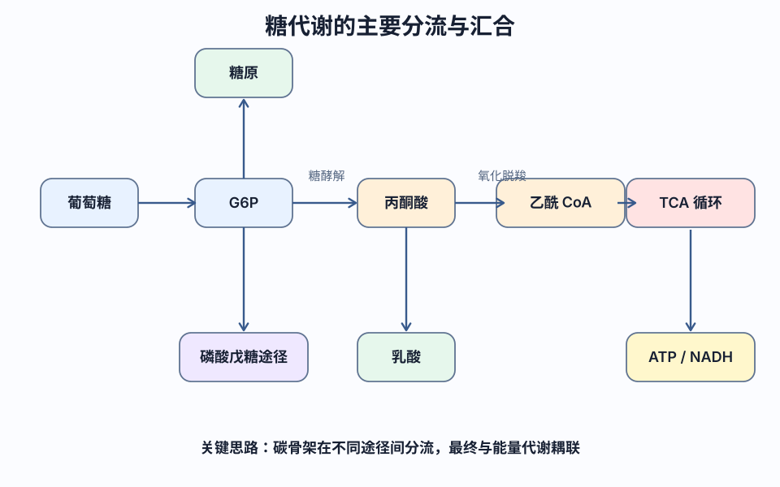

<!-- BEGIN AUTO-GENERATED NAVIGATION -->
> [!NOTE] 课程导航
> [← 上一篇：核酸](<BC 6 核酸.md>) · [课程目录](<COURSE_INDEX.md>) · [下一篇：大巧不工的幼教级米氏方程推导 →](<BC SP 大巧不工的幼教级米氏方程推导.md>)
<!-- END AUTO-GENERATED NAVIGATION -->

# BC 7：糖代谢
#生物化学 #糖类 #代谢 #糖酵解 #糖异生 #磷酸戊糖途径

## 1 糖的分解代谢

### 1.1 糖酵解和无氧氧化

- **关键酶**: 己糖激酶（肝内为 IV 型葡萄糖激酶）、磷酸果糖激酶-1（最重要）、丙酮酸激酶
    - 果糖-1, 6-二磷酸是磷酸果糖激酶-1 的反应产物，但可正反馈调节该酶
    - 果糖-2, 6-二磷酸是最强的变构激活剂
- **途径**: 糖酵解指产出丙酮酸的过程，糖酵解过程指产出乳酸的过程
- **能量**: 净产出 2 ATP

> [!NOTE]  
> 磷酸果糖激酶-1 是糖酵解途径中最重要的调控酶，受多种代谢物如 ATP、AMP、柠檬酸等调节。

> 图像的原始 URL、SHA-256 和许可状态见[图像来源与许可记录](../docs/image-sources.md)。

### 1.2 糖有氧氧化

- **关键酶**: 柠檬酸合酶、异柠檬酸脱氢酶、α-酮戊二酸脱氢酶复合体
- **反应**: 四次脱氢，两次脱羧，一次底物水平磷酸化
- **产物**: 1FADH₂、3NADH & H⁺、2CO₂、1GTP

---

## 2 糖原的合成与分解

### 2.1 肝糖原的合成

- **关键酶**: 糖原合酶（α-1, 4-糖苷键直链延伸），分支酶（α-1, 6-糖苷键支链）
- **能量**: 需要 ATP 和 UTP

### 2.2 肝糖原的分解

- **关键酶**: 糖原磷酸化酶（分解α-1, 4-糖苷键，产出 G-1-P），脱支酶（分解 α-1, 6-糖苷键，释放游离葡萄糖）

### 2.3 肝糖原分解合成调控

- **激素调节**: 胰高血糖素促进分解，胰岛素促进合成

> [!TIP]  
> 糖原代谢的激素调节是维持血糖稳态的重要机制，胰岛素和胰高血糖素通过cAMP信号通路影响糖原合酶和磷酸化酶的活性。

---

## 3 糖异生

- **关键酶**: 葡萄糖六磷酸酶、果糖二磷酸酶-1、丙酮酸羧化酶（最重要）、磷酸烯醇式丙酮酸羧激酶
- **生理意义**: 维持血糖水平，特别是在饥饿或剧烈运动时
- **乳酸循环（Cori Cycle）**: 肌肉产生的乳酸经血液循环至肝脏，转化为葡萄糖

> [!NOTE]  
> 糖异生与糖酵解在关键步骤上使用不同的酶，以实现独立的调控，避免无效循环。

---

## 4 磷酸戊糖途径

- **关键酶**: 葡萄糖六磷酸脱氢酶
- **产物**: 核糖五磷酸和 NADPH
- **生理意义**: NADPH 用于抗氧化，核糖五磷酸用于核酸合成

---

## 5 血糖及其调节

- **血糖浓度**: 空腹 3.9～5.6 mmol/L
- **激素调节**:
    - **胰岛素**: 降低血糖，促进葡萄糖利用和储存
    - **胰高血糖素**: 升高血糖，促进糖原分解和糖异生
    - **糖皮质激素**: 促进糖异生，抑制葡萄糖利用

> [!TIP]  
> 血糖水平受多种激素协同调节，胰岛素是唯一降低血糖的激素，而其他激素如胰高血糖素、肾上腺素和糖皮质激素均可升高血糖。

---

## 6 三大营养素代谢的关系

### 6.1 糖代谢与脂代谢的关系

1. 摄入的糖超过能量消耗时，葡萄糖会合成糖原储存在肝脏与肌肉中，或通过乙酰 CoA 合成脂肪
2. 脂肪的甘油部分能在体内转变为糖
3. 脂肪的分解代谢受糖代谢的影响

### 6.2 糖与氨基酸代谢的关系

1. 大部分氨基酸脱氨基后，生成相应的α-酮酸，可转变成糖（糖异生）
2. 糖代谢的中间产物可氨基化生成某些非必需氨基酸

### 6.3 脂类与氨基酸代谢的关系

1. 蛋白质可（经由乙酰 CoA）转变为脂肪
2. 氨基酸可作为合成磷脂的原料
3. 脂肪的甘油部分可以转变为非必需氨基酸

### 6.4 核酸与糖、蛋白质代谢的关系

1. 氨基酸是体内合成核酸的重要原料
2. 磷酸核糖由磷酸戊糖途径提供

## 7. 代谢调节【重点】

- **单细胞生物**：细胞水平代谢调节（原始调节），主要通过细胞内代谢物浓度的变化，调节酶活性和酶含量
- **高等生物**：三级代谢调节
	1. 细胞水平代谢调节 **（代谢调节的基础）**
		1. 酶活性调节（快）
		2. 酶含量调节（慢）
	2. 激素水平代谢调节
	3. 整体水平代谢调节

### 7.1 激素对代谢的调节

**哺乳动物激素的分类**
1. 氨基酸及其衍生物（含氮激素）
2. 肽及蛋白质（含氮激素）
3. 类固醇  *如性激素、肾上腺皮质激素*
4. 脂肪酸衍生物 *如前列腺素*

**激素作用机制**
1. 内外环境改变
2. 机体相关组织分泌激素
3. 激素与靶细胞上的受体结合
4. 靶细胞产生生物学效应，适应内外环境的改变

**激素的作用方式**

> [!NOTE] 第二信使假说
> - **第一信使**（如激素）把某种调节信息由分泌细胞带到靶细胞
> - 第一信使通过靶细胞膜上的激素受体（如 G 蛋白）激活**腺苷酸环化酶**，使 ATP 转变成 cAMP **（第二信使）**
> - 细胞内 cAMP 的变化引起了细胞特有的代谢活动发生变化

### 7.2 应激

**应激**：人体收到一些异乎寻常的刺激所做出一系列反应的紧张状态

应激状态时，交感神经兴奋，肾上腺髓质及皮质激素分泌增多，血浆胰高血糖素及生长激素水平增加，而胰岛素分泌减少